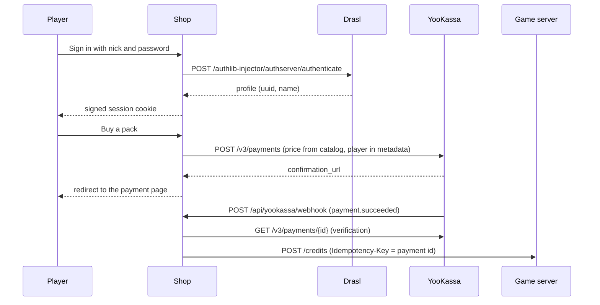

# Obrygatsii Shop

Web storefront for the in-game currency of a Minecraft game server. Players sign in with their server account, pick a currency pack, pay through YooKassa, and the balance is credited to the game automatically.

> Not an official Minecraft product. Not approved by or associated with Mojang or Microsoft.

## Features

- Sign-in through [Drasl](https://github.com/unmojang/drasl) (Yggdrasil and authlib-injector compatible auth server). Passwords are forwarded to Drasl and discarded, the session is a signed `httpOnly` cookie.
- Server-side catalog: prices never come from the client.
- YooKassa checkout with the redirect flow and an idempotent payment webhook.
- Currency is credited to the game server through a small authenticated HTTP contract.
- Legal and compliance pages needed by payment providers: public offer, privacy policy, delivery terms, contacts and requisites.
- Responsive UI themed after the game, Next.js image optimization, security headers.

## Tech stack

- Next.js 16 (App Router, Server Actions), React 19, TypeScript
- Tailwind CSS 4
- Zod for environment and input validation, jose for session tokens
- Vercel for hosting

## Architecture

The project follows [Feature-Sliced Design](https://feature-sliced.design). Next.js routes live in the root `app` directory and are thin re-exports of pages from `src/pages`. The root `pages` directory is an empty stub that stops Next.js from treating `src/pages` as the Pages Router.

| Layer | Slices |
| --- | --- |
| `app` | root layout, global styles, API route handlers |
| `pages` | home, shop, login, delivery, offer, privacy, contacts, payment-result, not-found |
| `widgets` | header, footer, hero, pack-showcase, screens-gallery, how-it-works, faq, legal-document |
| `features` | auth-by-drasl, buy-currency, confirm-payment |
| `entities` | currency-pack, session |
| `shared` | config, lib, ui, assets, api clients (Drasl, YooKassa, game server) |

Imports only go downwards, slices expose a public API through `index.ts`, and server-only modules are guarded with `server-only`.

```text
app/                      Next.js routes (re-exports only)
pages/                    stub for the Next.js and FSD name clash
src/
  app/                    layout, styles, API routes
  pages/                  page compositions
  widgets/                self-contained UI blocks
  features/               user scenarios
  entities/               business entities
  shared/                 reusable code, configuration, API clients
```

## Payment flow



The webhook never trusts the request body: it re-fetches the payment from YooKassa and checks status, currency and amount against the catalog before crediting. A failed credit returns a non-2xx response, so YooKassa retries the notification.

## Configuration

| Variable | Required | Description |
| --- | --- | --- |
| `SESSION_SECRET` | yes | Random string, at least 32 characters, used to sign sessions |
| `DRASL_URL` | yes | Base URL of the Drasl instance, including a path prefix if it has one |
| `SITE_URL` | no | Public URL of the shop, defaults to the Vercel production URL or `http://localhost:3000` |
| `YOOKASSA_SHOP_ID` | for payments | YooKassa shop identifier |
| `YOOKASSA_SECRET_KEY` | for payments | YooKassa secret key |
| `GAME_API_URL` | for crediting | Base URL of the game server credit API |
| `GAME_API_TOKEN` | for crediting | Bearer token for the game server credit API |

Seller details and legal copy live in `src/shared/config/site.ts`. The pack catalog lives in `src/entities/currency-pack/model/packs.ts`.

## Game server contract

```http
POST {GAME_API_URL}/credits
Authorization: Bearer <GAME_API_TOKEN>
Idempotency-Key: <YooKassa payment id>
Content-Type: application/json

{ "paymentId": "2f1c...", "playerUuid": "xxxxxxxx-xxxx-xxxx-xxxx-xxxxxxxxxxxx", "amount": 1000 }
```

Respond with any 2xx status once the balance is updated. The endpoint must be idempotent on `paymentId`, because notifications can be delivered more than once.

## Local development

```bash
npm install
cp .env.example .env.local
npm run dev
```

Useful scripts: `npm run build`, `npm run start`, `npm run typecheck`.

## Deployment

1. Import the repository into Vercel and set the environment variables above.
2. In the YooKassa dashboard, add an HTTP notification for `payment.succeeded` pointing to `https://<your-domain>/api/yookassa/webhook`.
3. Deploy. Every push to the main branch ships to production.

## Security notes

- Secrets are read only in server-only modules and never reach the client bundle.
- The session is an HS256 token in an `httpOnly`, `sameSite=lax` cookie, `secure` in production.
- The temporary Drasl access token is invalidated right after the profile is read.
- Redirect targets after sign-in are restricted to internal paths.
