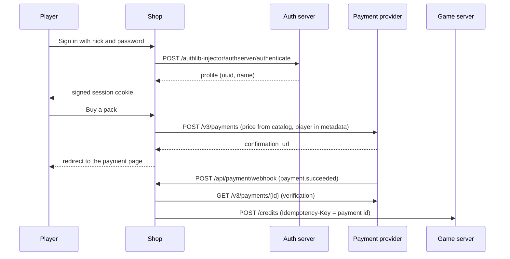
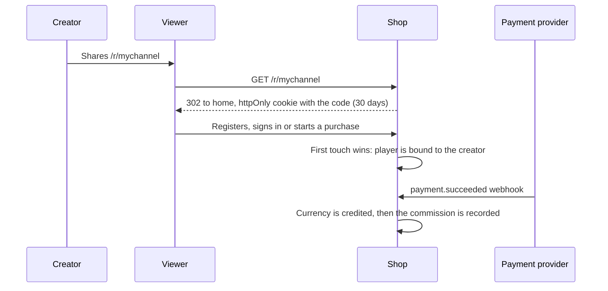

# cbo

Website of the cbo Minecraft game server. It presents the game, explains how to join, and includes a store where players top up the in-game currency: they sign in with their server account, pick a pack, pay online, and the balance is credited to the game automatically.

Live: https://shop.nekrasovdev.space

> Not an official Minecraft product. Not approved by or associated with Mojang or Microsoft.

## Features

- Account registration on the site itself: the form creates the account on the auth server through its admin API and signs the player in.
- A small JSON endpoint, `POST /api/account/register`, that lets the game launcher create accounts through the same admin API. It can require a stateless, HMAC-signed proof of work (`ACCOUNT_REGISTER_POW_BITS`), so automated signups cost the sender CPU time while verification costs the server one hash.
- Server landing page: game modes and features, screenshots, one-click launcher download and a three-step join guide.
- Launcher download: the site reads the electron-updater manifests published next to the launcher builds (`latest.yml`, `latest-mac.yml`, `latest-linux.yml`, `latest-linux-arm64.yml`), picks the newest build for each platform and links straight to the installer. The visitor's system is detected from the user agent on the server and refined in the browser through client hints, so the button already says "Download for Windows", "macOS" or "Linux". Manifests are cached for five minutes, and the last known builds are kept if the CDN is briefly unreachable.
- Sign-in with the same account the player uses in the launcher. Passwords are forwarded to the auth server and discarded, the session is a signed `httpOnly` cookie.
- Server-side catalog: prices never come from the client.
- Hosted checkout with the redirect flow and an idempotent payment webhook. The provider-specific calls live in a single module, `shared/api/payments`.
- Payment result page that asks the payment provider for the real status of the buyer's last payment, so leaving the checkout never shows a success message.
- Currency is credited to the game server through a small authenticated HTTP contract.
- Referral program for content creators: a creator picks a code, shares `/r/<code>`, and earns a percentage of every payment made by the players they bring. Attribution, hold period, balance and payout requests are described in the [Referral program](#referral-program) section.
- Legal and compliance pages needed by payment providers: public offer, privacy policy, delivery terms, contacts and requisites.
- Responsive flat dark UI with a single accent colour, chamfered buttons, large in-game screenshots and Oswald plus Inter typography, built from a small set of shared primitives.
- Next.js image optimization and security headers.

## Tech stack

- Next.js 16 (App Router, Server Actions), React 19, TypeScript
- Tailwind CSS 4 with a small component layer (plain CSS in `src/app/styles/globals.css`)
- Zod for environment and input validation, jose for session tokens
- PostgreSQL through `pg`, used only by the referral program (the rest of the site is stateless)
- Docker, Docker Compose and a self-hosted GitHub Actions runner for deployment

## Architecture

The project follows [Feature-Sliced Design](https://feature-sliced.design). Next.js routes live in the root `app` directory and are thin re-exports of pages from `src/pages`. The root `pages` directory is an empty stub that stops Next.js from treating `src/pages` as the Pages Router.

| Layer | Slices |
| --- | --- |
| `app` | root layout, global styles, API route handlers |
| `pages` | home, shop, login, register, partner, delivery, offer, privacy, contacts, payment-result, not-found |
| `widgets` | header, footer, hero, game-features, modes-preview, game-loop, feature-showcase, custom-play, shops-preview, screens-reel, server-mods, join-guide, pack-showcase, how-it-works, faq, legal-document, partner-intro, partner-dashboard |
| `features` | sign-in, sign-up, download-launcher, buy-currency, check-payment-status, confirm-payment, become-partner, request-payout, track-referral, process-payouts |
| `entities` | currency-pack, launcher, payment, session, partner |
| `shared` | config, lib, ui, assets, api clients (auth server, payments, game server, database) |

Imports only go downwards, slices expose a public API through `index.ts`, and server-only modules are guarded with `server-only`.

```text
app/                      Next.js routes (re-exports only)
pages/                    stub for the Next.js and FSD name clash
src/
  app/                    layout, styles, API routes
  pages/                  page compositions
  widgets/                self-contained UI blocks
  features/               user scenarios
  entities/               business entities
  shared/                 reusable code, configuration, API clients
```

## Payment flow



The webhook never trusts the request body: it re-fetches the payment from the provider and checks status, currency and amount against the catalog before crediting. A failed credit returns a non-2xx response, so the provider retries the notification.

The checkout page returns the buyer to `/payment/result` both after a successful payment and after leaving the checkout, so the redirect itself proves nothing. The id of the last payment is kept in a short-lived `httpOnly` cookie, and the result page asks the payment provider for its actual status before choosing between the paid, pending, canceled and unknown states.

## Configuration

| Variable | Required | Description |
| --- | --- | --- |
| `SESSION_SECRET` | yes | Random string, at least 32 characters, used to sign sessions |
| `DRASL_URL` | yes | Base URL of the auth server, including a path prefix if it has one |
| `DRASL_ADMIN_TOKEN` | for registration | API token of an admin account on the auth server. Without it the register page links to the auth server web form instead |
| `POSTGRES_PASSWORD` | Docker | Password of the bundled PostgreSQL container. Compose builds `DATABASE_URL` from it |
| `PROXY_NETWORK` | no | Docker network shared with the reverse proxy, defaults to `cbo_default` |
| `DATABASE_URL` | for referrals | PostgreSQL connection string. Without it the referral program is switched off and its links are hidden |
| `PARTNER_ADMIN_TOKEN` | for payouts | Bearer token (16+ characters) for the payout administration endpoint. Without it the endpoint answers 404 |
| `PARTNER_COMMISSION_PERCENT` | no | Default creator share of each payment, 1 to 50, defaults to `10`. Fixed per creator at sign-up |
| `PARTNER_HOLD_DAYS` | no | Optional days before a commission becomes payable, 0 to 90. Defaults to `0`, so commissions are payable immediately |
| `PARTNER_MIN_PAYOUT_RUB` | no | Minimum payout request in rubles, defaults to `500` |
| `SITE_URL` | no | Public URL of the shop, defaults to `http://localhost:3000`. Set it in production, it is used for metadata, referral links and redirects |
| `PAYMENT_SHOP_ID` | for payments | Shop identifier at the payment provider |
| `PAYMENT_SECRET_KEY` | for payments | Secret key at the payment provider |
| `GAME_API_URL` | for crediting | Base URL of the game server credit API |
| `GAME_API_TOKEN` | for crediting | Bearer token for the game server credit API |
| `SELLER_FULL_NAME` | for legal pages | Seller name shown in the footer, offer and contacts |
| `SELLER_INN` | for legal pages | Seller tax identification number |
| `SELLER_EMAIL` | for legal pages | Support and requisites email |
| `SELLER_PHONE` | for legal pages | Contact phone number |
| `SELLER_STATUS`, `SELLER_SUPPORT_HOURS` | no | Optional overrides for the status line and support hours |
| `SERVER_ADDRESS` | no | Game server address shown on the home page |
| `SERVER_VERSION` | no | Minecraft version shown next to the address, defaults to `1.20.1` |
| `COMMUNITY_URL`, `COMMUNITY_LABEL` | no | Link to the community chat and its button label |
| `LAUNCHER_CDN_URL` | no | Public address of the folder with launcher builds and update manifests, defaults to `https://cdn.nekrasovdev.space/launcher` |
| `LAUNCHER_URL` | no | Fallback download link (an absolute URL or a path such as `/launcher.zip`), used only when the manifests cannot be read |
| `LAUNCHER_NOTE` | no | Short note under the hero download button |

Seller details are read from the environment, so personal data never lands in the repository. Brand copy lives in `src/shared/config/site.ts`, the pack catalog in `src/entities/currency-pack/model/packs.ts`.

## Account registration

Only admin API tokens can create users on the auth server, so the shop calls its users endpoint with the token from `DRASL_ADMIN_TOKEN`, then signs the player in through the same endpoint used for login. The token never leaves the server. Use a dedicated admin account for it and rotate the token if it leaks. The form has a honeypot field, and the auth server validates the username and password rules.

## Game server contract

```http
POST {GAME_API_URL}/credits
Authorization: Bearer <GAME_API_TOKEN>
Idempotency-Key: <provider payment id>
Content-Type: application/json

{ "paymentId": "2f1c...", "playerUuid": "xxxxxxxx-xxxx-xxxx-xxxx-xxxxxxxxxxxx", "amount": 1000 }
```

Respond with any 2xx status once the balance is updated. The endpoint must be idempotent on `paymentId`, because notifications can be delivered more than once.

## Referral program

Creators sign in with their server account on `/partner`, pick a code and get a link such as `https://<your-domain>/r/mychannel`.



- **Attribution.** The cookie is turned into a binding on registration, sign-in and checkout. A player keeps the first creator who brought them, and a creator can never be attributed to themselves.
- **Commission.** Recorded after the currency has been credited, keyed by the provider payment id, so repeated webhook deliveries never pay twice. Amounts are stored as integer kopecks and the share is computed in integer arithmetic.
- **Hold period.** Optional and off by default. With `PARTNER_HOLD_DAYS` above zero a commission becomes payable only after that many days, which leaves room for refunds and chargebacks.
- **Payouts.** A creator requests the whole available balance from the cabinet. The request runs in a transaction that locks the creator row, so double submits and parallel requests cannot over-withdraw. Only one request can be pending at a time.
- **Storage.** `partners`, `referrals`, `commissions` and `payouts` tables are created on first use under a PostgreSQL advisory lock, so no separate migration step is needed.

Payout requests are processed through a small authenticated JSON endpoint:

```bash
# list pending requests
curl -H "Authorization: Bearer $PARTNER_ADMIN_TOKEN" https://<your-domain>/api/partner/payouts

# after sending the money, mark a request as paid (or "rejected")
curl -X POST -H "Authorization: Bearer $PARTNER_ADMIN_TOKEN" -H "Content-Type: application/json" \
  -d '{"id": 1, "status": "paid"}' https://<your-domain>/api/partner/payouts
```

Refunds are not wired to the commission ledger. If a payment is refunded, delete its row from `commissions` by `payment_id` before the creator requests a payout.

## Local development

```bash
npm install
cp .env.example .env.local
npm run dev
```

Useful scripts: `npm run build`, `npm run start`, `npm run typecheck`.

## Deployment

The site runs on your own server as two containers, the Next.js app (standalone output) and PostgreSQL. A reverse proxy that already runs in Docker terminates TLS in front of it.

**One-time server setup**

1. Create `~/cbo-shop/.env` and put every variable from the table above into it, including `POSTGRES_PASSWORD` (use a hex string so it is safe inside a URL), `SITE_URL` and `SESSION_SECRET`. Compose builds `DATABASE_URL` from the password.
2. Install a [self-hosted runner](https://docs.github.com/en/actions/hosting-your-own-runners) for this repository (Settings, Actions, Runners) in its own directory, run it as a service, and make sure its user can run `docker`. A runner serves a single repository, so it cannot be shared with other projects.
3. Attach the app to the network of your reverse proxy. The compose file joins the external network named by `PROXY_NETWORK` (default `cbo_default`, check with `docker network ls`) under the alias `cbo-shop`, so the proxy config is:

```caddyfile
shop.example.com {
    reverse_proxy cbo-shop:3000
}
```

4. In the payment provider dashboard add an HTTP notification for `payment.succeeded` pointing to `https://<your-domain>/api/payment/webhook`.

**CI/CD**

Every push to `main` runs `.github/workflows/deploy.yml` on the runner: it builds the Docker image, copies the compose file to `~/cbo-shop` and runs `docker compose up -d --wait`. The job fails if the app does not become healthy. Old images and build cache are pruned at the end of each run. The workflow has no `pull_request` trigger on purpose, so code from forks never reaches the runner.

To deploy by hand, run `docker build -t cbo-shop:latest .` and `docker compose up -d` in the project directory.

## Security notes

- Secrets are read only in server-only modules and never reach the client bundle.
- The session is an HS256 token in an `httpOnly`, `sameSite=lax` cookie, `secure` in production.
- The temporary access token is invalidated right after the profile is read.
- Redirect targets after sign-in are restricted to internal paths.
- The result page reports a payment only when its metadata matches the signed-in player.
- The payout endpoint compares the bearer token in constant time and is disabled unless a token is configured.
- All referral queries are parameterised, and the referral cookie value is validated before it reaches the database.

## Screenshots

Every picture on the landing page is a slot filled from `public/screens`. Drop a file in, and it replaces the placeholder, no code changes needed. Supported formats: `webp`, `avif`, `png`, `jpg`. Use 16:9 for everything.

| Path | Where it appears |
| --- | --- |
| `hero.webp` | Main frame next to the headline |
| `modes/team.webp`, `capture.webp`, `ffa.webp` | Top of the three mode cards |
| `features/loadout.webp`, `progress.webp` | The two feature sections |
| `gallery/*` | Screenshot grid with a lightbox, any number of files, sorted by name |
| `shops/coin.webp`, `donat.webp` | The two shop cards |

A missing file leaves a labelled placeholder. The exact file path is printed on the placeholder in `next dev`. In the gallery, a multiple of three images (3, 6, 9) gives the cleanest layout.
