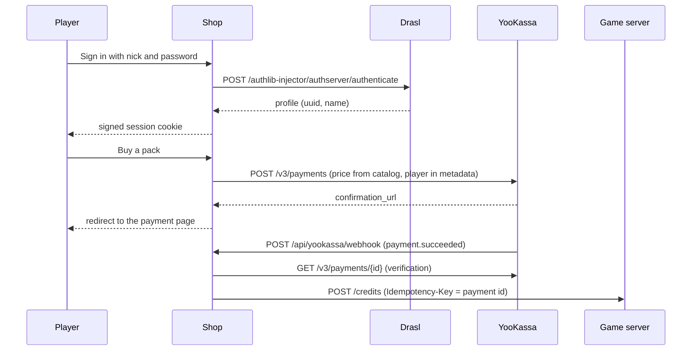

# cbo

Website of the cbo Minecraft game server. It presents the game, explains how to join, and includes a store where players top up the in-game currency: they sign in with their server account, pick a pack, pay through YooKassa, and the balance is credited to the game automatically.

Live: https://shop.nekrasovdev.space

> Not an official Minecraft product. Not approved by or associated with Mojang or Microsoft.

## Features

- Account registration on the site itself: the form creates the account through the Drasl admin API and signs the player in, so players never see the Drasl web UI.
- A small JSON endpoint, `POST /api/account/register`, that lets the game launcher create accounts through the same Drasl admin API. It can require a stateless, HMAC-signed proof of work (`ACCOUNT_REGISTER_POW_BITS`), so automated signups cost the sender CPU time while verification costs the server one hash.
- Server landing page: game modes and features, screenshots, one-click launcher download and a three-step join guide.
- Launcher download: the site reads the electron-updater manifests published next to the launcher builds (`latest.yml`, `latest-mac.yml`, `latest-linux.yml`, `latest-linux-arm64.yml`), picks the newest build for each platform and links straight to the installer. The visitor's system is detected from the user agent on the server and refined in the browser through client hints, so the button already says "Download for Windows", "macOS" or "Linux". Manifests are cached for five minutes, and the last known builds are kept if the CDN is briefly unreachable.
- Sign-in through [Drasl](https://github.com/unmojang/drasl) (Yggdrasil and authlib-injector compatible auth server). Passwords are forwarded to Drasl and discarded, the session is a signed `httpOnly` cookie.
- Server-side catalog: prices never come from the client.
- YooKassa checkout with the redirect flow and an idempotent payment webhook.
- Payment result page that asks YooKassa for the real status of the buyer's last payment, so leaving the checkout never shows a success message.
- Currency is credited to the game server through a small authenticated HTTP contract.
- Legal and compliance pages needed by payment providers: public offer, privacy policy, delivery terms, contacts and requisites.
- Responsive flat dark UI with a single accent colour, chamfered buttons, large in-game screenshots and Oswald plus Inter typography, built from a small set of shared primitives.
- Next.js image optimization and security headers.

## Tech stack

- Next.js 16 (App Router, Server Actions), React 19, TypeScript
- Tailwind CSS 4 with a small component layer (plain CSS in `src/app/styles/globals.css`)
- Zod for environment and input validation, jose for session tokens
- Vercel for hosting

## Architecture

The project follows [Feature-Sliced Design](https://feature-sliced.design). Next.js routes live in the root `app` directory and are thin re-exports of pages from `src/pages`. The root `pages` directory is an empty stub that stops Next.js from treating `src/pages` as the Pages Router.

| Layer | Slices |
| --- | --- |
| `app` | root layout, global styles, API route handlers |
| `pages` | home, shop, login, register, delivery, offer, privacy, contacts, payment-result, not-found |
| `widgets` | header, footer, hero, game-features, modes-preview, game-loop, feature-showcase, custom-play, shops-preview, screens-reel, server-mods, join-guide, pack-showcase, how-it-works, faq, legal-document |
| `features` | auth-by-drasl, register-by-drasl, download-launcher, buy-currency, check-payment-status, confirm-payment |
| `entities` | currency-pack, launcher, payment, session |
| `shared` | config, lib, ui, assets, api clients (Drasl, YooKassa, game server) |

Imports only go downwards, slices expose a public API through `index.ts`, and server-only modules are guarded with `server-only`.

```text
app/                      Next.js routes (re-exports only)
pages/                    stub for the Next.js and FSD name clash
src/
  app/                    layout, styles, API routes
  pages/                  page compositions
  widgets/                self-contained UI blocks
  features/               user scenarios
  entities/               business entities
  shared/                 reusable code, configuration, API clients
```

## Payment flow



The webhook never trusts the request body: it re-fetches the payment from YooKassa and checks status, currency and amount against the catalog before crediting. A failed credit returns a non-2xx response, so YooKassa retries the notification.

The checkout page returns the buyer to `/payment/result` both after a successful payment and after leaving the checkout, so the redirect itself proves nothing. The id of the last payment is kept in a short-lived `httpOnly` cookie, and the result page asks YooKassa for its actual status before choosing between the paid, pending, canceled and unknown states.

## Configuration

| Variable | Required | Description |
| --- | --- | --- |
| `SESSION_SECRET` | yes | Random string, at least 32 characters, used to sign sessions |
| `DRASL_URL` | yes | Base URL of the Drasl instance, including a path prefix if it has one |
| `DRASL_ADMIN_TOKEN` | for registration | API token of a Drasl admin account. Without it the register page links to the Drasl web form instead |
| `SITE_URL` | no | Public URL of the shop, defaults to the Vercel production URL or `http://localhost:3000` |
| `YOOKASSA_SHOP_ID` | for payments | YooKassa shop identifier |
| `YOOKASSA_SECRET_KEY` | for payments | YooKassa secret key |
| `GAME_API_URL` | for crediting | Base URL of the game server credit API |
| `GAME_API_TOKEN` | for crediting | Bearer token for the game server credit API |
| `SELLER_FULL_NAME` | for legal pages | Seller name shown in the footer, offer and contacts |
| `SELLER_INN` | for legal pages | Seller tax identification number |
| `SELLER_EMAIL` | for legal pages | Support and requisites email |
| `SELLER_PHONE` | for legal pages | Contact phone number |
| `SELLER_STATUS`, `SELLER_SUPPORT_HOURS` | no | Optional overrides for the status line and support hours |
| `SERVER_ADDRESS` | no | Game server address shown on the home page |
| `SERVER_VERSION` | no | Minecraft version shown next to the address, defaults to `1.20.1` |
| `COMMUNITY_URL`, `COMMUNITY_LABEL` | no | Link to the community chat and its button label |
| `LAUNCHER_CDN_URL` | no | Public address of the folder with launcher builds and update manifests, defaults to `https://cdn.nekrasovdev.space/launcher` |
| `LAUNCHER_URL` | no | Fallback download link (an absolute URL or a path such as `/launcher.zip`), used only when the manifests cannot be read |
| `LAUNCHER_NOTE` | no | Short note under the hero download button |

Seller details are read from the environment, so personal data never lands in the repository. Brand copy lives in `src/shared/config/site.ts`, the pack catalog in `src/entities/currency-pack/model/packs.ts`.

## Account registration

Drasl only lets admin API tokens create users, so the shop calls `POST /drasl/api/v2/users` (falling back to `v1`) with the token from `DRASL_ADMIN_TOKEN`, then signs the player in through the same authlib-injector endpoint used for login. The token never leaves the server. Use a dedicated admin account for it and rotate the token if it leaks. The form has a honeypot field, and Drasl itself validates the username and password rules.

## Game server contract

```http
POST {GAME_API_URL}/credits
Authorization: Bearer <GAME_API_TOKEN>
Idempotency-Key: <YooKassa payment id>
Content-Type: application/json

{ "paymentId": "2f1c...", "playerUuid": "xxxxxxxx-xxxx-xxxx-xxxx-xxxxxxxxxxxx", "amount": 1000 }
```

Respond with any 2xx status once the balance is updated. The endpoint must be idempotent on `paymentId`, because notifications can be delivered more than once.

## Local development

```bash
npm install
cp .env.example .env.local
npm run dev
```

Useful scripts: `npm run build`, `npm run start`, `npm run typecheck`.

## Deployment

1. Import the repository into Vercel and set the environment variables above.
2. In the YooKassa dashboard, add an HTTP notification for `payment.succeeded` pointing to `https://<your-domain>/api/yookassa/webhook`.
3. Deploy. Every push to the main branch ships to production.

## Security notes

- Secrets are read only in server-only modules and never reach the client bundle.
- The session is an HS256 token in an `httpOnly`, `sameSite=lax` cookie, `secure` in production.
- The temporary Drasl access token is invalidated right after the profile is read.
- Redirect targets after sign-in are restricted to internal paths.
- The result page reports a payment only when its metadata matches the signed-in player.

## Screenshots

Every picture on the landing page is a slot filled from `public/screens`. Drop a file in, and it replaces the placeholder, no code changes needed. Supported formats: `webp`, `avif`, `png`, `jpg`. Use 16:9 for everything.

| Path | Where it appears |
| --- | --- |
| `hero.webp` | Main frame next to the headline |
| `modes/team.webp`, `capture.webp`, `ffa.webp` | Top of the three mode cards |
| `features/loadout.webp`, `progress.webp` | The two feature sections |
| `gallery/*` | Screenshot grid with a lightbox, any number of files, sorted by name |
| `shops/coin.webp`, `donat.webp` | The two shop cards |

A missing file leaves a labelled placeholder. The exact file path is printed on the placeholder in `next dev`. In the gallery, a multiple of three images (3, 6, 9) gives the cleanest layout.
